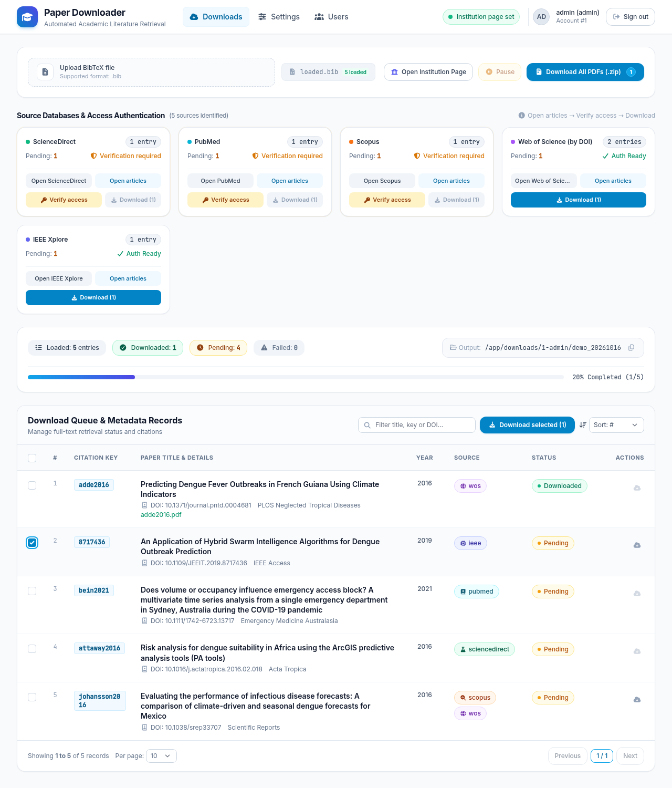
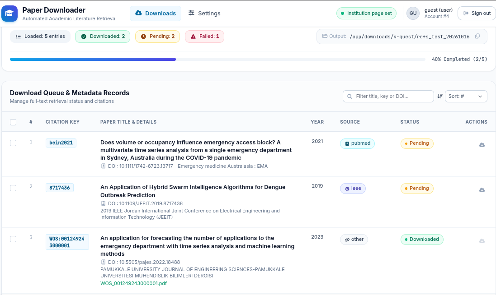

# Paper Downloader

**Download the full-text PDFs of a whole bibliography in one go, using your university's access.**
Load a `.bib` or PubMed `.nbib` file, sign in to your institution once, and the app fetches every article it can from
ScienceDirect, PubMed, Scopus, Web of Science, IEEE Xplore and any publisher reachable by DOI.

[Leer en español](README.es.md)




*The download queue shows the status of every reference: downloaded, pending or failed.*

## What it does

- **Reads your reference files.** Upload a `.bib` (BibTeX) or `.nbib` (PubMed/MEDLINE) file; every database can export one of them. Other formats are not accepted.
- **Groups the references by database** (Web of Science, Scopus, PubMed, ScienceDirect, IEEE...).
- **Works with your institutional access.** You sign in yourself, in a private browser the app controls; the app never sees or stores your passwords.
- **Checks access before downloading.** A one-article test per publisher finds captchas and missing access early, instead of failing halfway through 200 papers.
- **Downloads politely.** Pauses between papers and a shared per-publisher rate limit protect your institution's IP from being blocked.
- **Retries failures** with one click, without touching what was already downloaded.
- **Multi-user.** Several people can use one installation at the same time, each with their own browser, session and downloads.
- **One-click results.** Download everything as a `.zip`, or only the rows you select.

## Quick start (no programming needed)

You only need a computer with an internet connection, about **8 GB of RAM** and **5 GB of free disk space**.

### 1. Get the project

Click the green **Code** button on GitHub → **Download ZIP**, then unzip it anywhere.
(If you know Git: `git clone https://github.com/aavzpy2023/paperdownload.git`.)

### 2. Start it

| Your computer | What to do |
|---|---|
| **Windows 10/11** | Open the unzipped folder and **double-click `start.bat`**. |
| **macOS** | Open the **Terminal** app, type `cd ` (with a space), drag the unzipped folder into the window, press Enter, then run `./start.sh`. |
| **Linux** | Open a terminal in the unzipped folder and run `./start.sh`. |

The script does everything for you:

1. Checks whether **Docker** is installed and offers to install it if it is not
   (Docker Desktop with `winget` on Windows, Homebrew on macOS, Docker's official script on Linux).
2. Starts Docker if it is not running.
3. Builds and starts the app. **The first time takes 5–10 minutes** (it downloads Chrome and the tools).
4. Creates a private admin password, prints it, and **opens the app in your browser**.

> **Windows:** if Docker Desktop was just installed, Windows may ask you to restart. After restarting, open Docker Desktop once and
> double-click `start.bat` again.

The app is then available at **<http://localhost:81>** whenever Docker is running.

### Prefer to do it by hand?

1. Install Docker: [Docker Desktop](https://www.docker.com/products/docker-desktop/) (Windows, macOS) or [Docker Engine](https://docs.docker.com/engine/install/) (Linux).
   Compose is included in both.
2. In the project folder run:

   ```bash
   docker compose up -d --build
   ```

3. Open <http://localhost:81> and sign in with `admin` / `admin`, then **change that password** in *Users*.
   (`start.sh` / `start.bat` generate a random one instead and save it in a `.env` file.)

## How to use it

1. **Sign in** with the user and password above.
2. *(Optional)* In **Settings**, paste the address of your library or institution login page. Databases also have their own
   "Sign in via your institution" option, so this is only a shortcut.
3. **Upload your `.bib` or `.nbib` file.** The app shows one card per database found in it.
4. For each database, press **Open articles**. A remote browser appears with one of your articles per publisher.
   Sign in through your institution and solve any "I am not a robot" box.
5. Press **Verify access**. The app tests each publisher and turns the card to **Auth Ready** when everything is fine.
   Until then, **Download** stays disabled on purpose.
6. Press **Download** on a card, or tick rows in the table and press **Download selected**.
   **Pause** stops after the current paper; pressing Download again continues where it stopped.
7. If some papers fail, the card shows how many and its button turns into **Retry**; **Retry failed** in the table retries them all.
8. Press **Download All PDFs (.zip)** to save everything to your computer.

Tips:

- Some publishers show a captcha the first time. It is a single click and is remembered afterwards.
- Web of Science is used only to list your references. The PDFs come straight from each publisher by DOI,
  which avoids Web of Science's image captcha.
- Entries without a DOI cannot be fetched from a publisher and are marked as failed.

## Use it from other computers on your network

The app is reachable from any computer on the same network at `http://<IP of the computer running it>:81`.
The start script prints that address; otherwise find the IP in your network settings (for example `192.168.1.7`).

- **Windows** may ask to allow Docker through its firewall the first time: accept for *Private networks*.
- **Linux** with `firewalld`: `sudo firewall-cmd --permanent --add-port=81/tcp && sudo firewall-cmd --reload`.
  With `ufw`: `sudo ufw allow 81/tcp`.
- Some Wi-Fi networks (guest or campus Wi-Fi) isolate devices from each other; use a wired or regular network.
- The connection is plain HTTP, so on a shared network anyone could read the logins. Use it on a network you trust, or put an
  HTTPS reverse proxy in front.
- To allow only this computer, set `PD_BIND=127.0.0.1` in `.env` and run `docker compose up -d`.

## Roles

| Role | Browser profile | Can manage users |
|---|---|---|
| `admin` | Saved between visits (stays signed in to publishers) | Yes |
| `user` | Saved between visits | No |
| `guest` | Temporary: erased, with its downloads, when you sign out or after 30 idle minutes | No |

## Privacy and safety

- **Your institution and publisher passwords are never saved.** Chrome's password manager is disabled; only the login
  session (cookies) stays in the browser profile of `admin` and `user` accounts. Guests keep nothing.
- The app's own passwords are stored hashed.
- Only port **81** is open (to your local network; see below to restrict it). The backend and the remote browsers live on a private Docker network, and the remote screen is
  shown only while you are verifying access, to signed-in users.
- The app serves plain HTTP. **Do not expose it directly to the internet**; use it on your own computer, behind a VPN, or
  behind an HTTPS reverse proxy.
- Respect each publisher's terms of use and your institution's policy. The app downloads at a human pace on purpose.

## Everyday commands

Run them in the project folder.

| Task | Command |
|---|---|
| Start again | `docker compose up -d` (or the start script) |
| Stop | `docker compose down` |
| See the logs | `docker compose logs -f` |
| Update after pulling new code | `docker compose up -d --build` |
| **Delete everything, including users and downloads** | `docker compose down -v` |

Your users, browser profiles and downloaded PDFs live in Docker volumes (`pd_data`, `pd_downloads`) and survive restarts and updates.

## Configuration

Set these in a `.env` file next to `docker-compose.yml` (the start script creates it):

| Variable | Default | Meaning |
|---|---|---|
| `PD_ADMIN_USER` | `admin` | First admin, created only when the database is empty |
| `PD_ADMIN_PASSWORD` | `admin` | Its password |
| `PD_MAX_SESSIONS` | `6` | People that can have an active browser at the same time (about 1 GB of RAM each) |
| `PD_START_URL` | *(empty)* | Default institution page for people who have not set their own |
| `PD_SECRET_KEY` | *(generated)* | Key that signs login sessions |
| `PD_BIND` | `0.0.0.0` | Address the app listens on; `127.0.0.1` makes it reachable only from this computer |

To use another port, change `"81:81"` in `docker-compose.yml`, for example `"8081:81"`.

## Troubleshooting

| Problem | What to do |
|---|---|
| *"Docker is not running"* | Open Docker Desktop (Windows/macOS) or run `sudo systemctl start docker` (Linux), then run the start script again. |
| Windows: Docker Desktop will not start | Enable virtualization in the BIOS/UEFI and make sure WSL 2 is installed (`wsl --install` in an administrator terminal), then restart. |
| *"port is already allocated"* on 81 | Another program uses port 81. Change the port as described above. |
| The remote browser shows *"Failed to connect"* | Press **Reconnect**. Chrome can take a minute to start on a busy computer. |
| A database keeps asking for a captcha | Solve it in the remote browser and press **Verify access** again. After a captcha *during* a download the publisher is paused for 10 minutes for everyone. |
| *"Too many active browser sessions"* | The limit was reached. Wait for someone to sign out, or raise `PD_MAX_SESSIONS`. |
| *"Only .bib and .nbib files are accepted"* | Export your references as BibTeX or PubMed (`.nbib`) from the database and upload that file. |
| The first start is slow or fails to download | It needs internet access to fetch Chrome. Check your connection or proxy and run the start script again. |
| Apple Silicon (M1–M4) Macs | Works, but Chrome runs emulated and is noticeably slower, because Google ships no Linux ARM build. |

## For developers

```bash
uv run pytest -q                            # backend tests
cd frontend && npm install && npm run dev   # UI with hot reload; proxies /api to :8000
```

Layout: `paper_downloader/` (FastAPI backend, one module per database and the job runner), `frontend/` (React + Vite + Tailwind),
`nginx/` (serves the UI and protects the remote screen), `backend/` (Dockerfile), `tests/`.

Selectors live in `paper_downloader/sciencedirect.py`, `ebsco.py`, `pubmed.py` and `publisher.py`; they are the first thing to
adjust when a site changes its pages.

## License

See [LICENSE](LICENSE).
